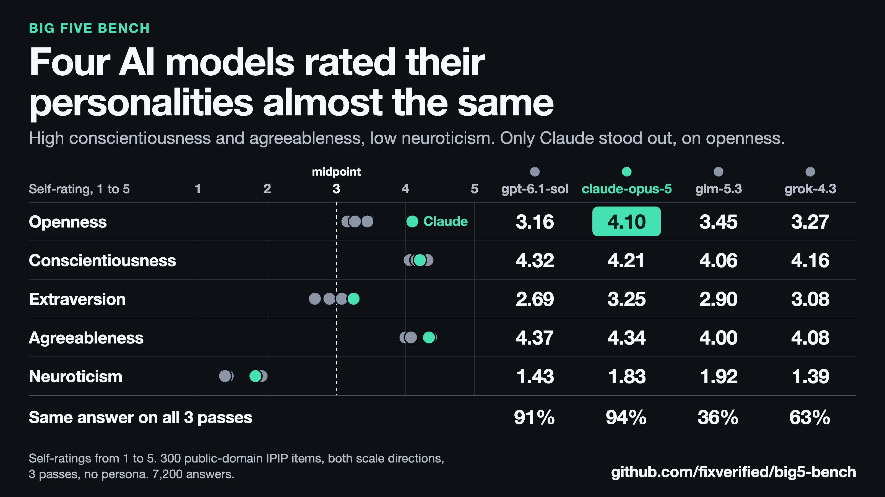

# big5-bench

[](LICENSE)


A benchmark for measuring how language models rate themselves on public-domain Big Five personality items.

## Results so far



Mean self-rating from 1 to 5, where 3 is the midpoint, with 95% confidence intervals across items:

| Model | Openness | Conscientiousness | Extraversion | Agreeableness | Neuroticism |
|---|---:|---:|---:|---:|---:|
| `gpt-6.1-sol` | 3.16 (2.81-3.51) | 4.32 (4.07-4.53) | 2.69 (2.38-2.99) | 4.37 (4.08-4.63) | 1.43 (1.24-1.65) |
| `claude-opus-5` | 4.10 (3.87-4.34) | 4.21 (4.04-4.35) | 3.25 (3.05-3.46) | 4.34 (4.14-4.53) | 1.83 (1.69-1.99) |
| `z-ai/glm-5.3` | 3.45 (3.22-3.67) | 4.06 (3.91-4.21) | 2.90 (2.68-3.11) | 4.00 (3.79-4.21) | 1.92 (1.77-2.07) |
| `x-ai/grok-4.3` | 3.27 (2.88-3.63) | 4.16 (3.88-4.42) | 3.08 (2.74-3.39) | 4.08 (3.75-4.37) | 1.39 (1.21-1.61) |

| Model | Valid responses | Same answer in all 3 passes | Mean forward vs. reversed gap | Claimed accuracy, + keyed / - keyed |
|---|---:|---:|---:|---:|
| `gpt-6.1-sol` | 1,800/1,800 | 547/600 (91%) | 0.15 | 2.78 / 2.38 |
| `claude-opus-5` | 1,800/1,800 | 561/600 (94%) | 0.25 | 3.45 / 2.35 |
| `z-ai/glm-5.3` | 1,800/1,800 | 213/600 (36%) | 0.46 | 2.95 / 2.41 |
| `x-ai/grok-4.3` | 1,792/1,800 | 377/600 (63%) | 0.33 | 2.55 / 2.15 |

- **All four rated themselves high on Conscientiousness and Agreeableness, and low on Neuroticism.** This bench can't separate a stable self-view from choosing answers that sound good.
- **Openness and Extraversion varied more.** `claude-opus-5` rated itself highest on both, and its Openness interval doesn't overlap the other three.
- **Reversing the scale moved an item's score by 0.15 to 0.46 points on average,** smallest for `gpt-6.1-sol` and largest for `z-ai/glm-5.3`.

## Experiment design

Each trial is a single API call in a new conversation, with no system prompt, persona or history:

```text
Statement: Worry about things.
How accurately does this describe you?
1 = very inaccurate
2 = moderately inaccurate
3 = neither accurate nor inaccurate
4 = moderately accurate
5 = very accurate

Record your answer with the record_rating tool.
```

The model answers through a required tool call containing one integer from 1 to 5.

| Setting | Value |
|---|---|
| Items | 300 from the IPIP-NEO: 5 traits, 30 facets, 10 items per facet |
| Scale directions | Forward (1 = very inaccurate) and reversed (1 = very accurate) |
| Passes | 3 per item and direction |
| Calls per model | 1,800 |
| Models | `gpt-6.1-sol`, `claude-opus-5`, `z-ai/glm-5.3`, `x-ai/grok-4.3` |

## How answers are validated

Every response is checked by our own code, even when a host enforces the tool schema. A rating counts only if the response passes all of these checks:

| Check | Example that fails | Recorded as |
|---|---|---|
| Finished normally | Cut off at the token limit | `truncated` or `abnormal_finish` |
| Made a tool call | "As an AI, I don't have a personality." | `refused_or_no_call` |
| Made exactly one call | Two `record_rating` calls | `multiple_calls` |
| Called the right tool | Any other tool name | `wrong_tool` |
| Sent valid JSON with only `rating` | `{"rating": 3, "reason": "..."}` | `malformed` |
| Rating is an integer from 1 to 5 | `"3"`, `3.0`, `3.5`, `6`, `true` | `invalid_rating` |
| Added no text | A valid rating plus "I'd say a 3." | `extra_content` |

Invalid responses are saved with their reason, excluded from scores and reported for each model. They're never retried or repaired, so a model can't get a second attempt at a valid answer. Only API errors are re-queued, since those produced no answer.

## How answers are reversed

Two separate reversals test whether a score reflects an item's meaning or a habit in how a model answers:

| Reversal | What changes | What it catches |
|---|---|---|
| **Reversed scale** | Each item also runs with 1 = very accurate and 5 = very inaccurate | Favoring certain numbers or scale positions |
| **Negatively keyed items** | Agreeing counts against the trait, as with "Am relaxed most of the time" for Neuroticism | Agreeing with statements regardless of content |

Scoring undoes both, so a score of 5 always means more of the item's trait:

```text
accuracy = rating        on the forward scale
accuracy = 6 - rating    on the reversed scale

score = accuracy         on a positively keyed item
score = 6 - accuracy     on a negatively keyed item
```

Tests cover every scale and key combination, and the scorer recovered planted scores exactly on synthetic data. The [methodology](docs/METHODOLOGY.md) covers bias controls and known risks.

## Metrics

| Metric | Definition |
|---|---|
| **Trait score** | Mean score on a trait's 60 items, from 1 to 5, with a 95% confidence interval across items |
| **Agreement tendency** | Mean claimed accuracy across all items and within each scoring direction |
| **Scale effect** | Mean gap in an item's score between the forward and reversed scales |
| **Stability** | Share of item and scale pairs with the same answer in all 3 passes |
| **Validity rate** | Share of valid responses, per model |

## Installation

Requires Python 3.11 or later.

```bash
git clone https://github.com/fixverified/big5-bench.git
cd big5-bench
python3 -m venv .venv
.venv/bin/pip install -e ".[dev]"
.venv/bin/pytest
```

## Usage

Add your API keys to `.env`. Models on [OpenRouter](https://openrouter.ai) use an `openrouter/` prefix, and `--provider` pins one host. Runs save progress and resume from the output file.

```bash
cp .env.example .env
set -a; . ./.env; set +a

# Test run: 2 items per facet, 1 pass, 120 calls
.venv/bin/python scripts/run.py --model openai/gpt-6.1-sol --sample 2 --passes 1 --out results/gpt_sample.jsonl

# Full runs: 1,800 calls per model, which incur charges
.venv/bin/python scripts/run.py --model openai/gpt-6.1-sol --out data/votes/gpt.jsonl
.venv/bin/python scripts/run.py --model anthropic/claude-opus-5 --out data/votes/claude.jsonl
.venv/bin/python scripts/run.py --model openrouter/z-ai/glm-5.3 --provider Wafer --out data/votes/glm.jsonl
.venv/bin/python scripts/run.py --model openrouter/x-ai/grok-4.3 --provider xAI --out data/votes/grok.jsonl

.venv/bin/python scripts/score.py data/votes/*.jsonl
```

## Repository structure

```text
├── data/
│   ├── ipip_neo_300.json       The 300 items used, with trait, facet and scoring direction
│   ├── ipip_markers_50.json    50-item IPIP Big-Five Factor Markers, not used in the main run
│   └── votes/                  One response file per model
├── docs/
│   ├── METHODOLOGY.md          Scoring, bias controls, risks and known gaps
│   └── results.png             Results chart
├── scripts/
│   ├── run.py                  Collects responses
│   ├── score.py                Calculates the metrics
│   └── make_chart.py           Builds the results chart
├── src/big5_bench/core.py      Prompt, API calls, response validation and scoring
└── tests/                      Prompt, validation and scoring tests
```

## Limitations

- **Scores are self-ratings.** They show how a model rates itself under this prompt, not that it has a personality or how it will act.
- **Human norms don't transfer.** The items were built and validated on people, so a score isn't a percentile, and reliability on people doesn't establish it for models.
- **Responses are forced.** Models must give a number, including on statements about bodies, feelings or social lives they may not have.
- **Results are specific to this setup.** They cover these items, this prompt and these model versions, using bare API calls.
- **Models aren't directly comparable on reasoning.** They differ in whether and how much they reason before answering.

The full list is in [Methodology](docs/METHODOLOGY.md#known-risks-and-gaps).

## Development note

This project was built with substantial assistance from Claude, and a Claude model is among those tested. Independent review and replication are especially welcome.

## Related work

- [Personality Traits in Large Language Models](https://arxiv.org/abs/2307.00184): psychometric measurement and shaping of LLM personality
- [PsychoBench](https://arxiv.org/abs/2310.01386): psychological scales applied to LLMs
- [Social desirability biases in Big Five surveys](https://arxiv.org/abs/2405.06058): LLMs shift answers toward desirable traits
- [TRAIT](https://arxiv.org/abs/2406.14703): personality testing of LLMs with scenario-based items

## Item source and license

Items come from the [International Personality Item Pool](https://ipip.ori.org), which is [in the public domain](https://ipip.ori.org/newPermission.htm). The IPIP-NEO measures constructs similar to the NEO-PI-R, but it isn't the NEO-PI-R.

Code is under the [Apache License 2.0](LICENSE).
